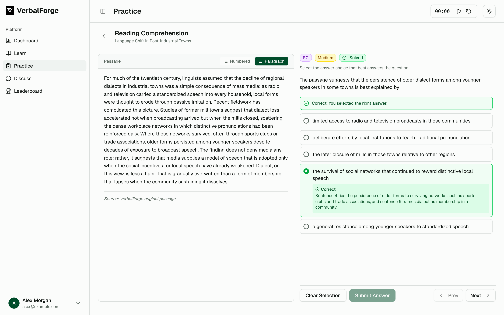

# VerbalForge AI

VerbalForge is a GRE verbal practice platform whose questions are generated by an LLM pipeline. This repository is that pipeline: a background Python service that generates text completion, sentence equivalence, and reading comprehension questions, validates them, and stores them in MongoDB.

Live site: https://www.verbalforge.xyz (may be offline)



*Screenshot of the web app with a demo question written for the screenshot.*

## What this repo does

The service runs three independent async workers, one per question type, each on its own interval from `config.yaml`:

| Worker | Generates | Input |
| --- | --- | --- |
| TC runner | Text completion (1 to 3 blanks) | Target vocabulary words from the MongoDB `words` collection |
| SE runner | Sentence equivalence | Target vocabulary words from the MongoDB `words` collection |
| RC runner | Reading comprehension passages with questions | Articles fetched from public science and culture sites, tracked so each article is used once |

Each generation cycle goes through the pipeline in `src/core/`:

1. **Prompt**: build a type-specific prompt (`src/core/prompts/`) with difficulty and topic or word context.
2. **Generate**: call OpenAI or Azure OpenAI and parse the response.
3. **Validate**: load each question into Pydantic models and run structural and quality checks (required fields, choice structure, text length, blank count); invalid questions are dropped.
4. **Store**: write questions and passages to MongoDB with `published_at` unset, so they stay hidden until an admin publishes them through the backend.

Worker state (last and next run) is persisted in MongoDB, so restarts resume the schedule instead of starting over.

## Stack

Python, asyncio, OpenAI Python SDK (OpenAI and Azure OpenAI), Pydantic and pydantic-settings, PyMongo, Requests and Beautiful Soup for article fetching, PyYAML.

## Run locally

Requires Python 3.9+, a reachable MongoDB, and an OpenAI or Azure OpenAI API key. The TC and SE workers need words in the `words` collection (added through the admin UI).

```bash
make run
```

`make run` creates `venv/` if needed, installs `requirements.txt`, and starts the server via `scripts/start_server.sh`. If you already have a `.venv/`, `make dev` starts the server with that interpreter.

Environment variables (read from `.env` in the project root):

| Variable | Default | Purpose |
| --- | --- | --- |
| `OPENAI_API_KEY` | none | OpenAI key. Used if set. |
| `AZURE_OPENAI_API_KEY` | none | Azure OpenAI key. Used if no OpenAI key is set. |
| `AZURE_OPENAI_ENDPOINT`, `AZURE_OPENAI_DEPLOYMENT_NAME` | none | Azure OpenAI endpoint and deployment. |
| `AZURE_OPENAI_API_VERSION` | `2024-02-15-preview` | Azure OpenAI API version. |
| `LLM_MODEL` | `gpt-4` | Model name. |
| `LLM_TEMPERATURE` | `0.7` | Sampling temperature. |
| `MONGODB_URI` | `mongodb://localhost:27017/` | MongoDB connection string. |
| `MONGODB_DATABASE` | `verbalforge` | Database name. |

`config.yaml` sets each worker's interval, how many questions per difficulty it generates per cycle, questions per RC passage, and logging.

Other commands:

| Command | Effect |
| --- | --- |
| `make lint` | Flake8 over `src/` |
| `make format` | Black over `src/` (rewrites files) |
| `make reset-state` | Clears persisted worker schedules, then starts the server |
| `make reset-articles` | Clears used-article tracking, then starts the server |
| `make clean-db` | Deletes MongoDB data. Destructive. |

## Project layout

```
src/core/     Prompts, LLM calls, Pydantic models, validation, formatting
src/server/   Workers, scheduler, MongoDB persistence, article sources
scripts/      Startup and database maintenance scripts
config.yaml   Worker intervals, question counts, logging
```

## Related repositories

| Repo | Role |
| --- | --- |
| [verbalforge-frontend](https://github.com/VerbalForge/verbalforge-frontend) | Next.js practice and admin UI |
| [verbalforge-backend](https://github.com/VerbalForge/verbalforge-backend) | Go/Gin REST API that serves published questions from the same MongoDB |
| **verbalforge-ai** (this repo) | Question generation and validation workers |
